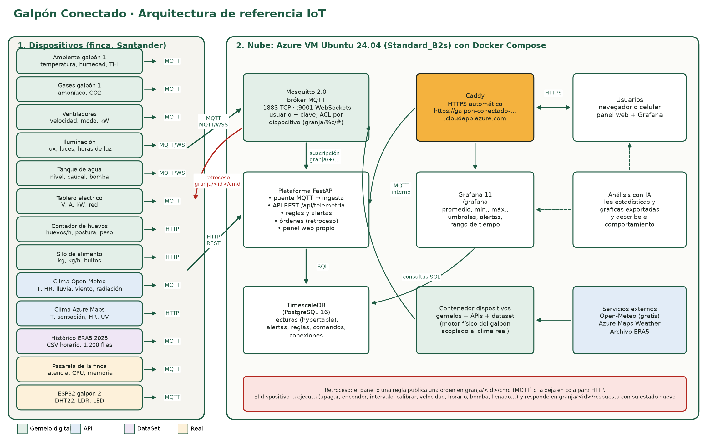

# Galpón Conectado: Parcial 2 de IoT a la medida

Monitoreo y control de un galpón de gallinas ponedoras (4.800 aves Hy-Line Brown, Santander). Hay 13 dispositivos de cuatro tipos (gemelo digital, API, dataset y real), un bróker MQTT, una plataforma propia con reglas y órdenes de retroceso, TimescaleDB, Grafana y un panel web, todo desplegado en una VM de Azure con su propia URL HTTPS.

Es la parte IoT de la Granja App, la app de la granja familiar: mismo galpón, misma línea genética y el alimento medido en bultos de 40 kg.



## Dispositivos

| # | Dispositivo | Tipo | Origen | Protocolo | Variables (rango) | Órdenes propias |
|---|---|---|---|---|---|---|
| 1 | `galpon1-ambiente` | Gemelo digital | Modelo físico del galpón | MQTT | temperatura 15-40 °C, humedad 30-100 %, THI 60-90 | — |
| 2 | `galpon1-gases` | Gemelo digital | Modelo físico del galpón | MQTT | amoníaco 0-60 ppm, CO2 400-5000 ppm | — |
| 3 | `galpon1-ventilacion` | Gemelo digital | Modelo físico del galpón | MQTT | velocidad 0-100 %, modo auto 1/0, potencia 0-2 kW | velocidad, modo |
| 4 | `galpon1-iluminacion` | Gemelo digital | Modelo físico del galpón | MQTT sobre WebSockets | luz 0-400 lux, luces 1/0, horas de luz 0-24 | horario, forzar |
| 5 | `tanque-agua` | Gemelo digital | Modelo físico del galpón | MQTT sobre WebSockets | nivel 0-100 %, caudal 0-5 L/min, bomba 1/0, consumo del día 0-2000 L | bomba, umbral |
| 6 | `tablero-energia` | Gemelo digital | Modelo físico del galpón | MQTT | voltaje 0-130 V, corriente 0-40 A, potencia 0-5 kW, red 1/0 | simular_corte |
| 7 | `contador-huevos` | Gemelo digital | Curva Hy-Line Brown | HTTP REST | huevos/h 0-1500, huevos del día 0-5000, postura 0-100 %, peso 45-75 g, rotos | aves |
| 8 | `silo-alimento` | Gemelo digital | Modelo de consumo | HTTP REST | nivel 0-8000 kg, consumo 0-80 kg/h, bultos 0-200 | llenado |
| 9 | `clima-openmeteo` | API | Open-Meteo, clima actual real | HTTP de consulta + MQTT de envío | temperatura, humedad, lluvia, viento, radiación, nubosidad | — |
| 10 | `clima-azure-maps` | API | Azure Maps Weather (Atlas) | HTTP REST | temperatura, sensación, humedad, punto de rocío, UV, nubosidad | — |
| 11 | `historico-era5` | DataSet | CSV ERA5 de nov-dic 2025, mismo punto | MQTT | temperatura, humedad, lluvia, radiación | desfase |
| 12 | `pasarela-finca` | Real | Equipo que corre la pasarela (psutil) | MQTT | latencia al bróker 0-2000 ms, CPU %, memoria %, horas encendido | — |
| 13 | `galpon2-ambiente` | Real | ESP32 + DHT22 + LDR (Wokwi o físico) | MQTT | temperatura, humedad, luz | led |

Los gemelos 1 a 8 comparten un modelo físico del galpón (`dispositivos/granja_dispositivos/modelo.py`):

- La temperatura interior sigue al clima exterior real que publica `clima-openmeteo`, más el calor de las aves y menos el efecto de la ventilación.
- El amoníaco y el CO2 bajan con la ventilación.
- Los cortes de luz apagan los ventiladores, las luces y la bomba.
- La postura sigue la curva de la línea Hy-Line Brown y cae con el calor.
- El agua y el alimento se consumen sobre todo con luz y con calor.

Cambiar algo en un dispositivo, como la velocidad de los ventiladores o el horario de luz, se nota en los demás.

## Comunicación

Bróker: **Mosquitto 2.0**.
- MQTT en el puerto 1883.
- WebSockets en el 9001, publicado como `wss://<dominio>/mqtt` detrás de Caddy.
- Usuario y clave obligatorios.
- ACL `pattern readwrite granja/%c/#`: cada dispositivo solo escribe en sus propios tópicos.

| Tópico | Sentido | Contenido |
|---|---|---|
| `granja/<id>/telemetria` | dispositivo → plataforma | `{"ts": "...", "valores": {"temperatura": 26.1, ...}}` (QoS 1) |
| `granja/<id>/estado` | dispositivo → plataforma (retenido) | encendido, intervalo, calibración y estado propio |
| `granja/<id>/conexion` | dispositivo → plataforma (retenido, último deseo) | `en_linea` o `desconectado` |
| `granja/<id>/cmd` | plataforma → dispositivo | `{"id": "...", "accion": "calibrar", "parametros": {...}}` |
| `granja/<id>/respuesta` | dispositivo → plataforma | `{"comando_id": "...", "ok": true, "mensaje": "...", "estado": {...}}` |
| `granja/alertas` | plataforma → suscriptores | alerta abierta o resuelta |

Los dispositivos HTTP envían a `POST /api/telemetria/<id>` con la cabecera `X-Clave`. La respuesta trae las órdenes pendientes, el dispositivo las ejecuta y contesta en `POST /api/dispositivos/<id>/respuestas`.

## Retroceso

Todo dispositivo acepta estas órdenes:
- `apagar`: deja de medir pero sigue escuchando órdenes.
- `encender`.
- `intervalo` (5 a 3600 s).
- `calibrar`: valor × factor + offset, por variable.
- `reiniciar_calibracion`.

Además, cada uno acepta las órdenes propias de la tabla. El estado se guarda en disco (en el ESP32, en su memoria flash), así que sobrevive a un reinicio. Las órdenes salen del panel web o de una regla. Por ejemplo, amoníaco sobre 25 ppm pone los ventiladores al 100 %.

## Plataforma

`plataforma/` es una API FastAPI que:
- Recibe MQTT y HTTP y guarda cada lectura en TimescaleDB.
- Evalúa reglas con histéresis: una sola alerta por episodio, con su valor extremo.
- Manda órdenes, marca desconectados a los dispositivos que se callan y sirve el panel web.

| Ruta | Para qué |
|---|---|
| `GET /api/dispositivos` | estado y últimos valores |
| `GET /api/dispositivos/<id>/serie?variable=&horas=&paso=` | promedio, mínimo y máximo por intervalo |
| `GET /api/resumen?horas=` | promedio, mínimo y máximo de todas las variables |
| `POST /api/dispositivos/<id>/comandos` | enviar una orden (clave del panel) |
| `GET/POST/PUT/DELETE /api/reglas` | reglas editables |
| `GET /api/alertas`, `/api/comandos`, `/api/conexiones` | historial |

Grafana (`grafana/paneles/galpon.json`, generado con `grafana/generar_panel.py`) muestra:
- Indicadores del momento.
- Series con umbrales.
- Mínimo y máximo, y la comparación de las tres fuentes de clima.
- Estados de red, luces y bomba.
- Un explorador de cualquier variable.
- Tablas de estadísticas, alertas y órdenes del rango de tiempo elegido. Las alertas aparecen como anotaciones.

## Despliegue en Azure

En PowerShell, desde la raíz:

```powershell
.\scripts\entrar.ps1                       # az login
.\scripts\crear_vm.ps1                     # grupo rg-parcial2-iot, VM Standard_B2s, puertos 80/443/1883, dominio de Azure
.\scripts\desplegar.ps1                    # copia el repo, genera .env y levanta docker compose
.\scripts\migrar.ps1                       # pasa los datos capturados en local y arranca los gemelos en la nube
.\local\pasarela_nube.ps1                  # la pasarela real de este equipo envía a la nube
```

Las claves se generan solas y quedan en `.secretos/nube.json`, que no entra al repositorio.

## Correr en local

```powershell
python -m venv .venv; .venv\Scripts\pip install -r plataforma\requirements.txt -r dispositivos\requirements.txt amqtt
.\local\iniciar.ps1      # bróker amqtt, plataforma en http://127.0.0.1:8000 y los dispositivos
.\local\detener.ps1
```

Pruebas: `cd plataforma; ..\.venv\Scripts\python -m pytest pruebas` y lo mismo en `dispositivos`.

## ESP32

`wokwi/galpon2-ambiente/` tiene el firmware (`sketch.ino`), el circuito (`diagram.json`) y las librerías. Para usarlo:
1. Copia `secrets.ejemplo.h` como `secrets.h` con el dominio y la clave de dispositivos.
2. Pega los archivos en un proyecto nuevo de Wokwi ESP32. No lo guardes público, porque lleva la clave.

El mismo código sirve en una tarjeta física cambiando la red WiFi.
